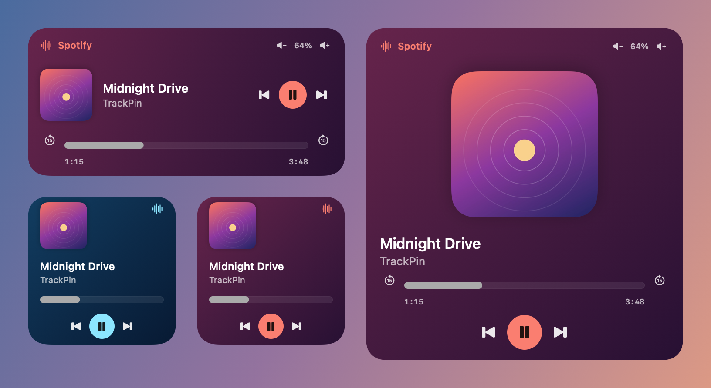
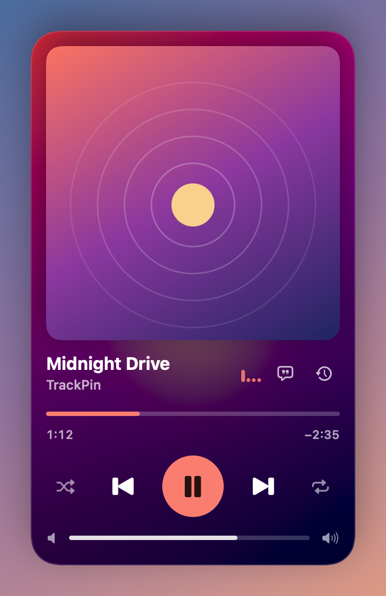
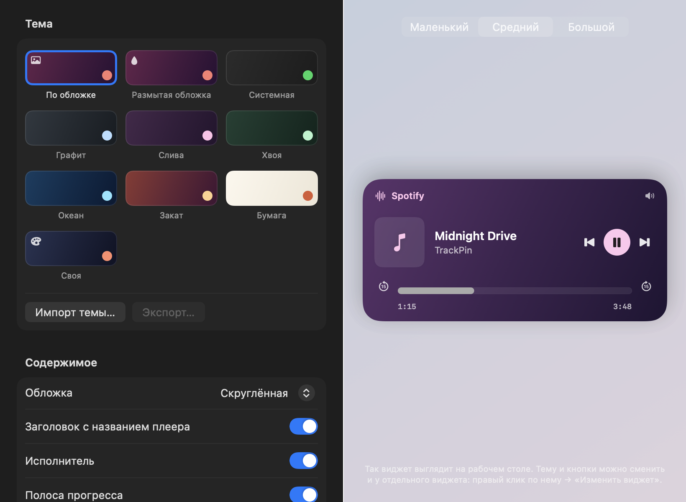
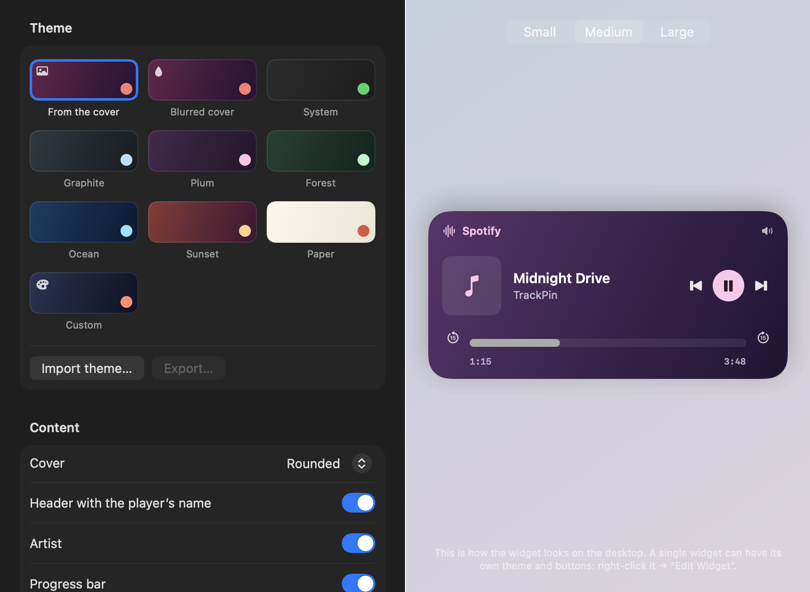

# TrackPin


Виджет для рабочего стола macOS и мини-плеер для Spotify, Apple Music и Яндекс Музыки.
[English below](#english)



## Возможности

- **Виджет на рабочем столе** трёх размеров: обложка, трек, прогресс, кнопки паузы и переключения,
  перемотка и громкость прямо на виджете. Второй виджет «Обложка» показывает обложку во весь размер.
- **Мини-плеер** открывается по нажатию на виджет и вырастает из точки клика. Большая обложка,
  перемотка, перемешивание, повтор, громкость, синхронизированный текст песни и история прослушиваний.
- **Темы**: цвета по обложке, размытая обложка, 7 готовых тем и своя тема с редактором цветов,
  экспортом и импортом. Прозрачность фона настраивается отдельно для виджета и мини-плеера.
- **Горячие клавиши** из любого приложения: ⌃⌥Пробел пауза, ⌃⌥→ и ⌃⌥← следующий и предыдущий трек,
  ⌃⌥P мини-плеер.
- **Жесты в мини-плеере**: свайп двумя пальцами влево или вправо переключает трек, прокрутка
  меняет громкость.
- **Статистика**: время прослушивания за неделю по дням, топ исполнителей и треков (Настройки →
  «Статистика»). Считается только на этом Mac.
- **Таймер сна**, уведомление о смене трека, название трека в строке меню, иконка в Dock по желанию.
- **Бережёт батарею**: читает плеер внутри приложения и только когда тот сообщает о смене трека.
- **Автообновление** через Sparkle, интерфейс на русском и английском.

<p>
  
  
</p>

## Установка

1. Скачай `TrackPin-<версия>.dmg` со страницы [Releases](https://github.com/lan4ikDev/trackpin-macos/releases/latest).
2. Открой DMG и перетащи TrackPin в папку «Программы».
3. Запусти TrackPin. Приложение подписано сертификатом разработчика, но не нотаризовано Apple, поэтому
   при первом запуске macOS может его заблокировать. Тогда открой «Системные настройки» → «Конфиденциальность
   и безопасность», пролистай вниз и нажми «Всё равно открыть».
4. Когда macOS спросит, разреши TrackPin управлять Spotify (или Apple Music). Для приложения
   Яндекс Музыки нужен «Универсальный доступ», TrackPin подскажет, где его включить.

Нужна macOS 14 Sonoma или новее.

## Как пользоваться

- **Добавить виджет.** Правый клик по рабочему столу → «Изменить виджеты» → найди TrackPin слева →
  перетащи «Плеер» или «Обложка» нужного размера на стол.
- **Мини-плеер.** Нажми на виджет (не на кнопки), на иконку TrackPin в строке меню или ⌃⌥P. Пробел ставит
  на паузу, ← → перематывают, ↑ ↓ меняют громкость, H показывает историю, Esc закрывает.
- **Настройки.** Правый клик по иконке в строке меню → «Настройки…» (или ⌘, в мини-плеере). Вкладки:
  «Виджет» (тема, кнопки, прозрачность), «Мини-плеер», «Основные» (источник музыки, язык, автозапуск,
  обновления, энергосбережение), «Доступ и помощь».
- **Тема одного виджета.** Правый клик по виджету → «Изменить виджет».
- **TrackPin должен работать в фоне**, иначе виджет не узнает о новом треке. Автозапуск при входе включён
  по умолчанию.
- **Виджет серый?** Когда поверх стола открыты окна, macOS приглушает виджеты. Выбери стиль «Цветной» в
  «Системных настройках» → «Рабочий стол и Dock».

## Сборка из исходников

Нужны macOS 14+ и Xcode 16+. XcodeGen скачается сам при первой сборке.

```bash
./build.sh --install        # собрать, заменить /Applications/TrackPin.app и перезапустить
./scripts/make-dmg.sh       # собрать build/TrackPin-<версия>.dmg
./scripts/release.sh        # DMG, подпись Sparkle, релиз на GitHub и запись в appcast.xml
```

`build.sh` подписывает первым сертификатом Apple Development из Связки ключей (подойдёт любой Apple ID:
Xcode → Settings → Accounts) или командой из `TRACKPIN_TEAM=ABCDE12345`. Каждый push и PR собирает
GitHub Actions с `--self-test`.

### Как выпустить версию

1. Подними `MARKETING_VERSION` и `CURRENT_PROJECT_VERSION` в `project.yml`.
2. Опиши изменения в `docs/releases/<версия>.md` (абзацы и списки «- »). Если файла нет, `release.sh`
   сам набросает его из коммитов и остановится, чтобы ты его поправил.
3. Закоммить и запушь всё в `main`, затем запусти `./scripts/release.sh`. Скрипт проверит, что версия
   и номер сборки выросли, соберёт DMG, подпишет его ключом Sparkle, создаст на GitHub релиз с тегом
   `<версия>` (нужен `gh`), дождётся, пока DMG станет доступен, и только потом запушит `appcast.xml`
   с описанием изменений. `--no-publish` только соберёт DMG и обновит `appcast.xml` локально.
4. Нотаризация: с платным аккаунтом разработчика и сертификатом Developer ID Application один раз
   выполни `xcrun notarytool store-credentials trackpin …` и выпускай через
   `TRACKPIN_DEVELOPER_ID=1 ./scripts/release.sh`. Тогда macOS не будет блокировать первый запуск.

## Как это работает

Виджеты WidgetKit живут в песочнице и не могут управлять другими приложениями, поэтому всю работу делает
приложение TrackPin: читает плеер через AppleScript (Spotify, Apple Music), Accessibility (приложение
Яндекс Музыки) или JavaScript во вкладке браузера (music.yandex.ru), качает обложку и отдаёт снимок
состояния виджету по локальному соединению 127.0.0.1. Кнопки виджета — это App Intents, которые
пересылают команду приложению. Подробности в исходниках: `Sources/Player.swift`,
`Sources/WidgetPublisher.swift`, `Shared/WidgetTransport.swift`.

TrackPin — независимый проект и не связан со Spotify, Apple или Яндексом.

---

## English

TrackPin is a macOS desktop widget and mini player for Spotify, Apple Music and Yandex Music.

**Features:** widgets in three sizes with playback, seek and volume buttons; a vertical mini player that
opens from the widget with a big cover, seek bar, shuffle, repeat, volume, synced lyrics and play history;
cover based, built-in and custom themes with import and export; background opacity; global shortcuts
(⌃⌥Space, ⌃⌥→, ⌃⌥←, ⌃⌥P); sleep timer; track change notifications; optional Dock icon and menu bar
title; Sparkle updates; Russian and English interface.



**Install:** download the DMG from [Releases](https://github.com/lan4ikDev/trackpin-macos/releases/latest),
drag TrackPin to Applications and open it. The app is signed with a development certificate but not
notarized, so macOS may block the first launch: open System Settings → Privacy & Security and click
“Open Anyway”. Allow TrackPin to control Spotify or Apple Music when asked. Requires macOS 14 or later.

**Use:** right-click the desktop → Edit Widgets → TrackPin. Click the widget, the menu bar icon or press
⌃⌥P for the mini player (Space, arrows, H, Esc work there). Settings are in the menu bar icon’s menu.
TrackPin has to keep running for the widget to stay current; it starts at login by default.

**Build:** `./build.sh --install` builds and installs, `./scripts/make-dmg.sh` makes a DMG and
`./scripts/release.sh` signs it for Sparkle and updates `appcast.xml`. Requires Xcode 16 or later;
XcodeGen is downloaded on first use.

TrackPin is an independent project and is not affiliated with Spotify, Apple or Yandex.
