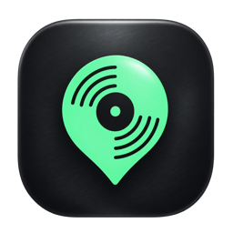

# TrackPin



A macOS menu bar controller for the Spotify desktop app and an experimental WidgetKit extension. The menu bar controller can show the current track and seek to a specific timestamp. It starts in the background. Open the player explicitly from the menu bar.

The extension is designed as a static WidgetKit card for the desktop. It shows artwork, progress and playback controls. The progress indicator is read-only. The bundled extension compiled successfully, but the ad hoc signed build did not appear in the widget gallery on the Mac tested with macOS 26.7.3. Gallery registration and live widget behavior still need verification through Xcode.

## Build

Requires macOS 14 or later and the Xcode Command Line Tools.

```bash
./build.sh
open build/TrackPin.app
```

The script builds the app and extension, checks the local code signatures and runs the playback decoder checks. TrackPin reads and controls the Spotify desktop app using macOS Automation. The native widget reads current playback from the running app over a local loopback connection.

TrackPin is an independent project and is not affiliated with Spotify.
